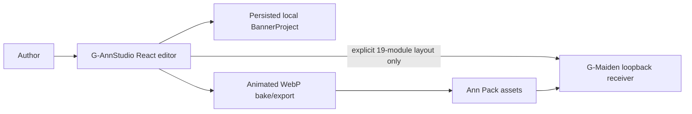

# G-AnnStudio PRD & SDD v0.1

## Document control

This document follows IEEE 29148-2018 requirement framing and IEEE 1016-2009 design-description framing. It consolidates existing approved feature specifications; it does not supersede their explicit contracts.

## Layer 1 — Product requirements

### Purpose and users

G-AnnStudio is a local desktop tool for authors creating voice, banner, and overlay-event assets for G-Maiden. An author must be able to compose and preview assets without accidentally changing a live game overlay.

### Scope boundaries

- G-AnnStudio owns local authoring drafts and explicit local handoff.
- G-Maiden owns live overlay settings and rendering.
- Cloud project sync is excluded until its separate C-3/HIGH security contract is approved.
- Match, CV, GSI, G-Log, identity, and recovery data must never enter an authoring-project store.

### Functional requirements

| ID | Requirement | Source |
| --- | --- | --- |
| FR-001 | Author a non-destructive local banner project with assets and ordered layers. | GOE-001 |
| FR-002 | Edit banner geometry and styling through canvas and inspector paths. | GOE-002 |
| FR-003 | Preview a selected event against a Dota HUD reference. | GOE-004 |
| FR-004 | Export only a runtime-safe banner format to G-Maiden. | GOE-003 |
| FR-005 | Arrange and explicitly sync only the 19-module HUD layout over loopback. | G-Overlay Lab sync |

### Non-functional requirements

| ID | Requirement |
| --- | --- |
| NFR-001 | Source media remains immutable; the project records edits as metadata. |
| NFR-002 | The authoring editor remains usable when G-Maiden is not running. |
| NFR-003 | A raw authoring video is never sent to G-Maiden’s runtime overlay. |
| NFR-004 | Local project persistence never uploads game-state data. |

### Business rules and acceptance

| ID | Rule / acceptance criterion |
| --- | --- |
| BR-001 | Only the explicit **Sync to G-Maiden** action may write HUD geometry to G-Maiden. |
| BR-002 | Cloud sync must remain unavailable without an approved identity, authorization, storage, conflict, and retention contract. |
| AC-001 | A user can import SVG/image/video, compose visible layers, select them by canvas or layer tree, and edit their values. |
| AC-002 | A selected event preview appears over a HUD reference before installation. |
| AC-003 | Invalid layout sync leaves the prior G-Maiden layout intact. |

## Layer 2 — Software design

### Architecture overview

### Design decisions

| ID | Decision |
| --- | --- |
| SDD-001 | `BannerProject` is separate from the existing 19-module `OverlayLayout` draft. |
| SDD-002 | Layer operations are non-destructive and use a bounded local history. |
| SDD-003 | G-Maiden handoff is format-bounded: static image or baked animation, never raw runtime video. |
| SDD-004 | HUD sync uses a local, validated loopback contract and is never cloud sync. |

### Security, error, testing, and delivery

- Private project cloud storage is future work governed by `GOE-005`; it has no implementation authorization.
- UI failures retain the last valid local project. G-Maiden rejects invalid layout payloads atomically.
- Current verification includes TypeScript type-check, graph/preflight review, code-doc alignment, and a configured focused Vitest suite of 18 tests across four files. `preflightBannerProject` is a pure, currently unwired candidate validator; GOE-003 remains partial because encoded-byte approval, bake/install wiring, and G-Maiden renderer evidence are still open.
- The desktop delivery surface is Tauri; no hosted runtime service or external telemetry is part of this package.

## Layer 3 — Operations and quality

- Treat G-Maiden as optional during authoring; unavailable sync must be clear and non-destructive.
- Preserve the local-only privacy boundary in every new integration.
- Update traceability and the document graph whenever requirements or feature-boundary code changes.

## Related documents

- [Architecture](ARCHITECTURE.md)
- [G-Overlay Lab editor spec](g-overlay-lab-figma-editor-spec.md)
- [Traceability](appendices/D-traceability.md)

## CHANGELOG

| Version | Date | Status | Summary | Commit Hash | Agent |
| --- | --- | --- | --- | --- | --- |
| 0.1.0 | 2026-08-11 | beta | Consolidated existing product, editor, sync, and security boundaries into the 3-layer core document. | pending | ATHER |
| 0.1.1 | 2026-08-12 | beta | Corrected current focused-test and pure-preflight status while retaining GOE-003 as partial. | pending | ATHER |
