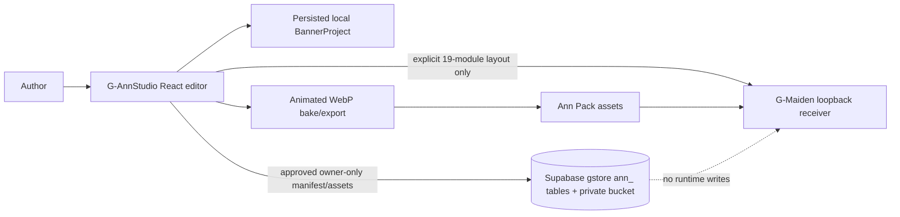

# G-AnnStudio PRD & SDD v0.1

## Document control

This document follows IEEE 29148-2018 requirement framing and IEEE 1016-2009 design-description framing. It consolidates existing approved feature specifications; it does not supersede their explicit contracts.

## Layer 1 — Product requirements

### Purpose and users

G-AnnStudio is a local desktop tool for authors creating voice, banner, and overlay-event assets for G-Maiden. An author must be able to compose and preview assets without accidentally changing a live game overlay.

### Scope boundaries

- G-AnnStudio owns local authoring drafts and explicit local handoff.
- G-Maiden owns live overlay settings and rendering.
- Cloud project sync is authorized only through the approved C-3/HIGH contract in [the private cloud threat model](gann-cloud-threat-model.md); hosted enablement remains gated by migration and operational evidence.
- Match, CV, GSI, G-Log, identity, and recovery data must never enter an authoring-project store.

### Functional requirements

| ID | Requirement | Source |
| --- | --- | --- |
| FR-001 | Author a non-destructive local banner project with assets and ordered layers. | GOE-001 |
| FR-002 | Edit banner geometry and styling through canvas and inspector paths. | GOE-002 |
| FR-003 | Preview a selected event against a Dota HUD reference. | GOE-004 |
| FR-004 | Export only a runtime-safe banner format to G-Maiden. | GOE-003 |
| FR-005 | Arrange and explicitly sync only the 19-module HUD layout over loopback. | G-Overlay Lab sync |
| FR-006 | Diagnose the selected FFmpeg executable, Python executable, sidecar scripts, and required local Python modules before media analysis. | ANN-RUNTIME-001 |
| FR-007 | Import, cut, and export media without overwriting the source or pre-existing output files. | ANN-RUNTIME-002 |
| FR-008 | Report local pack file creation separately from G-Maiden activation/reload acceptance. | ANN-RUNTIME-003 |
| FR-009 | Package the sidecar scripts and provide a CPU-only setup path that does not download inference models. | ANN-RUNTIME-004 |

### Non-functional requirements

| ID | Requirement |
| --- | --- |
| NFR-001 | Source media remains immutable; the project records edits as metadata. |
| NFR-002 | The authoring editor remains usable when G-Maiden is not running. |
| NFR-003 | A raw authoring video is never sent to G-Maiden’s runtime overlay. |
| NFR-004 | Local project persistence never uploads game-state data. |
| NFR-005 | Speech processing selects CPU by default; GPU use requires an explicit per-run choice. |
| NFR-006 | A failed media or install operation leaves pre-existing source and destination files byte-for-byte unchanged. |

### Business rules and acceptance

| ID | Rule / acceptance criterion |
| --- | --- |
| BR-001 | Only the explicit **Sync to G-Maiden** action may write HUD geometry to G-Maiden. |
| BR-002 | Cloud sync may expose only owner-authenticated BannerProject metadata and author assets through the approved identity, authorization, storage, conflict, and retention contract; it remains unavailable until hosted migration and cleanup evidence are approved. |
| AC-001 | A user can import SVG/image/video, compose visible layers, select them by canvas or layer tree, and edit their values. |
| AC-002 | A selected event preview appears over a HUD reference before installation. |
| AC-003 | Invalid layout sync leaves the prior G-Maiden layout intact. |
| AC-004 | Runtime health reports executable versions, required sidecar scripts and Python modules with actionable failures, without model inference. |
| AC-005 | A synthetic WAV can be imported, cut, exported and probed; its source hash stays unchanged and a collision preserves the existing target bytes. |
| AC-006 | Installation into a disposable G-Maiden fixture reports local files and endpoint accepted/rejected/unavailable states separately. |

## Layer 2 — Software design

### Architecture overview

### Design decisions

| ID | Decision |
| --- | --- |
| SDD-001 | `BannerProject` is separate from the existing 19-module `OverlayLayout` draft. |
| SDD-002 | Layer operations are non-destructive and use a bounded local history. |
| SDD-003 | G-Maiden handoff is format-bounded: static image or baked animation, never raw runtime video. |
| SDD-004 | HUD sync uses a local, validated loopback contract and is never cloud sync. |
| SDD-005 | FFmpeg, Python, and sidecar scripts resolve through explicit overrides, the packaged/local tools locations and PATH. Python prefers its configured app environment before a base interpreter; Settings exposes health and paths. |
| SDD-006 | FFmpeg media outputs are written to unique staging paths and committed only when destination names are unused. Activation status is independent of local file creation. |
| SDD-007 | The desktop app passes `--device cpu` to Whisper and does not expose GPU inference. A manual sidecar CLI run must explicitly select a GPU device. |
| SDD-008 | A build-time G-Maiden install endpoint override exists only for isolated acceptance; it accepts HTTP loopback hosts and the existing `/announcer/install` path. The normal endpoint stays `127.0.0.1:3000`. |

### Security, error, testing, and delivery

- Private project cloud storage is governed by `GOE-005` and [the approved threat model](gann-cloud-threat-model.md). The bounded migration/client slice is authorized; hosted production enablement, cleanup-worker retention, public sharing, and runtime writes are not.
- UI failures retain the last valid local project. G-Maiden rejects invalid layout payloads atomically.
- Frontend verification includes TypeScript type-check and 33 configured Vitest tests across seven files. Focused Tauri Rust tests pass 6/6. A Windows debug custom-protocol app launched through Tauri WebDriver and passed eight isolated-identifier Tauri bridge/IPC checks for runtime diagnostics, synthetic WAV import/cut/export and FFmpeg probes, collision preservation, disposable pack activation, unchanged source, and SQLite pack persistence across a full app-process restart. A separate debug run passed native CPU Whisper with an exact normalized 28-word English fixture match. The isolated-identifier rerun used explicit sidecar paths and did not repeat model inference. These are debug acceptance results, not a release installer test; packaged-resource fallback, native OCR, `.ann` project-dialog save/open, a visual click-through of every screen, Thai/live-game quality, and live G-Maiden integration remain unverified. `preflightBannerProject` is a pure candidate validator; GOE-003 remains partial because encoded-byte approval, live bake/install, and G-Maiden renderer evidence are still open. GOE-005 remains partial because hosted migration, cleanup retention, and signed-URL live evidence are still open.
- The desktop delivery surface is Tauri; no hosted runtime service or external telemetry is part of this package.
- Standalone runtime readiness, safe file output, and truthful G-Maiden activation reporting are specified in [the runtime safety specification](g-annstudio-runtime-safety-spec.md). The editor/cloud frontend suite does not establish native sidecar readiness or successful audio processing.

## Layer 3 — Operations and quality

- Treat G-Maiden as optional during authoring; unavailable sync must be clear and non-destructive.
- Preserve the local-only privacy boundary in every new integration.
- Update traceability and the document graph whenever requirements or feature-boundary code changes.

## Related documents

- [Architecture](ARCHITECTURE.md)
- [G-Overlay Lab editor spec](g-overlay-lab-figma-editor-spec.md)
- [Traceability](appendices/D-traceability.md)

## CHANGELOG

| Version | Date | Status | Summary | Commit Hash | Agent |
| --- | --- | --- | --- | --- | --- |
| 0.1.0 | 2026-08-11 | beta | Consolidated existing product, editor, sync, and security boundaries into the 3-layer core document. | pending | ATHER |
| 0.1.1 | 2026-08-12 | beta | Corrected current focused-test and pure-preflight status while retaining GOE-003 as partial. | pending | ATHER |
| 0.2.0 | 2026-08-14 | candidate | Bound GOE-005 to the approved private-cloud threat model/RLS contract while preserving local-first and runtime exclusions. | pending | ATHER |
| 0.3.0 | 2026-10-15 | candidate | Add standalone runtime diagnostics, safe media output, install/activation result separation, packaged sidecar resources, and a CPU-default speech contract under issue #5. | pending | Codex |
| 0.4.0 | 2026-10-15 | candidate | Refine Python discovery to prefer the app-local sidecar environment, record truthful manifest activation status and collision-safe export behavior, and link native acceptance evidence when complete. | pending | Codex |
| 0.5.0 | 2026-10-15 | candidate | Specify loopback-only endpoint acceptance and record the 33-test frontend evidence while native checks continue. | pending | Codex |
| 0.6.0 | 2026-10-15 | candidate | Record 6/6 focused Rust tests and native debug IPC/media/pack acceptance with the packaged-resource, release-artifact, and live-integration gates still open. | pending | Codex |
