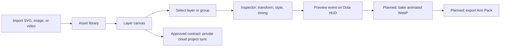

# G-Overlay Lab: Figma-grade banner editor

## Decision

G-AnnStudio will evolve G-Overlay Lab into a layer-based banner editor. It is a professional local authoring surface inspired by Figma's direct manipulation and Canva's asset-first composition. It produces assets for G-Maiden only.

The existing layout sync contract remains unchanged: it sends only the 19-module overlay geometry to G-Maiden over loopback. Banner-project sync is a separate private cloud capability and must never send match, CV, GSI, account-recovery, or G-Log data.

## Requirement map

| ID | Requirement | Status |
| --- | --- | --- |
| GOE-001 | Authors can compose a banner from a selectable, ordered, non-destructive layer tree. | Partially implemented: local `BannerProject`, ordered/nested layers, inherited visibility/lock, import, selection, group/ungroup, duplicate, reorder, and delete |
| GOE-002 | Canvas and inspector provide equivalent, keyboard-accessible transform and styling edits. | Partially implemented: shift-select, marquee-select, drag, resize, snap-to-grid, align/distribute, numeric/text/style inspector fields, and Ctrl/Cmd undo/redo |
| GOE-003 | Motion assets are baked into a G-Maiden-renderable image format, never sent as a raw runtime video. | Partial: existing Animated WebP bake; `BannerProject` stores optional per-layer Start/End ms timing and has a pure candidate preflight. Composition/timing bake, Ann Pack installation, and runtime handoff remain open. |
| GOE-004 | A preview shows the selected event over a Dota HUD reference before export. | Partially implemented: current layout event preview |
| GOE-005 | Private cloud sync protects projects and assets with revision conflict handling and no game-data egress. | Partial: approved local projection/sync helper and schema candidate; hosted migration/evidence pending |

## Author workflow



## Editor shell

- **Top toolbar:** project title, undo, redo, select/hand tools, zoom, preview, export, and sync status.
- **Asset rail:** imported SVG, images, and video, plus generated banner art. Assets can be searched, dragged, and placed on the canvas.
- **Canvas:** 16:9 banner artboard over an optional Dota HUD reference, with pan, zoom, grid, rulers, safe zones, snapping, multi-select, marquee selection, alignment, and distribution.
- **Layers panel:** ordered tree, visibility, lock, grouping, nesting, rename, duplicate, delete, and keyboard selection.
- **Inspector:** type-specific properties for the selected layer, including numeric transform fields. A keyboard user can perform all canvas edits through this inspector.
- **Motion timing (current):** the inspector stores optional per-layer `startMs` and `endMs` metadata only. A timeline, trim, enter/exit presets, and keyframes are future candidate work; they are not part of the current `BannerProject` v1 schema.

## Layer document v1

```ts
type LayerKind = "group" | "text" | "shape" | "image" | "svg" | "video";

type Transform = {
  x: number; y: number; width: number; height: number;
  rotation: number; opacity: number;
};

type Layer = {
  id: string;
  kind: LayerKind;
  name: string;
  parentId: string | null;
  order: number;
  visible: boolean;
  locked: boolean;
  transform: Transform;
  style: Record<string, unknown>;
  content: Record<string, unknown>;
  timing?: { startMs: number; endMs: number };
};

type BannerProject = {
  schemaVersion: 1;
  id: string;
  title: string;
  eventId: string;
  artboard: { width: number; height: number; safeZonePreset: "dota-hud" | "none" };
  assets: Asset[];
  layers: Layer[];
  revision: number;
};
```

All layer edits are non-destructive. The original asset path and content identity stay unchanged; trim, crop, transform, effects, and timing are project metadata.

## Required interactions

- Select, shift-select, marquee-select, group, ungroup, duplicate, delete, lock, hide, and reorder layers.
- Drag, resize with handles, rotate, constrain proportions, snap to guide/grid, align, and distribute selections.
- Edit X, Y, width, height, rotation, opacity, font, fill, stroke, crop, and timing in the inspector.
- Use `Ctrl/Cmd+Z` and `Ctrl/Cmd+Shift+Z` for undo/redo. Pointer move/resize commits one grouped history command when the pointer is released.
- Preview a chosen G-Maiden event against the HUD reference using the local authored-animation ceiling of 3.5 seconds. The target runtime display lifetime is a 4.0-second show phase plus a 0.8-second exit phase; full runtime parity remains open.

## Media and runtime boundary

- SVG, image, and video are authoring inputs. SVG is never a runtime handoff format: it must be rasterized into an approved runtime asset before handoff.
- A video layer can be trimmed and composed locally, but it is not shipped as a raw video to the G-Maiden overlay.
- Runtime handoff may use only approved raster output: static PNG/WebP or animated WebP. The existing G-AnnStudio `bake_animated_webp` command is the animation delivery path; it is not yet wired to `BannerProject` composition/timing or Ann Pack installation.
- `preflightBannerProject` is a pure candidate validator, currently unwired from bake/install. It checks the candidate plan for unsupported layers, missing assets, decode failure, duration, frame, and dimension limits without mutating the project. The encoded-byte budget remains unapproved, so no byte-size rejection is active.

## Local project persistence

- The editor stores `BannerProject` separately from the existing announcer pack and the existing 19-module `OverlayLayout` draft. The current localStorage-backed baseline accepts imported assets up to 3 MB; file-backed local asset storage is part of the motion/export phase.
- Persist local draft changes atomically. Asset files remain in the local project/asset library and are referenced by stable IDs, not arbitrary remote paths.
- Use a bounded history of patch-based commands. Drag, resize, reorder, and multi-layer alignment must not create one history record per pointer move.

## Private cloud sync: C-3 / HIGH — approved contract

Cloud sync is not an extension of the loopback G-Maiden layout route. The threat model and RLS contract is approved in [the private cloud threat model](gann-cloud-threat-model.md). This approval authorizes only the bounded implementation described there; hosted deployment, cleanup-worker operation, and production enablement remain separate evidence gates.

### In scope for the approved cloud contract

- Authenticated owner-only banner projects, project manifest revisions, and author-uploaded assets.
- Explicit states: local-only, syncing, synced, conflict, offline, and failed.
- Revision-based conflict detection. A conflict must offer keep-local, use-cloud, or duplicate-project; it must never silently overwrite a draft.
- Private Supabase `gstore` tables (`ann_projects`, `ann_project_assets`) and the private `ann-project-assets` bucket, with least-privilege owner checks, opaque UUID paths, five-minute maximum signed URLs, and tombstone deletion.
- A cloud projection validator that strips local paths/data URLs and rejects game, identity-security, and telemetry keys before upload; the database repeats the forbidden-key check as defense in depth.

### Explicit exclusions

- No GSI, match, CV, audio telemetry, G-Log, Steam identity, recovery factors, entitlement, or Google-account security data.
- No public gallery, share link, collaborative editing, comments, or third-party asset marketplace in this feature.
- No direct cloud-to-G-Maiden runtime writes. Installation and layout sync remain local and explicit.

### Approved design gate and remaining implementation gates

1. **Approved:** Google OAuth/Supabase Auth session, shared `gstore` project, dedicated tables and private bucket, and `auth.uid()` owner authorization.
2. **Approved:** threat model, RLS/authorization rules, retention/deletion, signed-URL expiry, per-object ceiling, and offline/conflict behavior in [the threat model](gann-cloud-threat-model.md).
3. **Required before hosted use:** schema migration and pgTAP evidence, rollback/audit runbook, cross-account denial tests, security-advisor review, and a separately approved cleanup worker/retention interval.
4. **Still not shipped:** client sync UI, hosted migration, signed-URL live smoke, and production enablement.

## Implementation phases

1. **Local editor core:** layer document, asset rail, canvas selection/transform, layers tree, inspector, grouped undo/redo, and local persistence.
2. **Motion export:** video trim, motion timeline, preview, Animated WebP bake, and export preflight.
3. **Private cloud sync:** implement only the approved contract in [the threat model](gann-cloud-threat-model.md); do not expand into sharing, collaboration, or runtime sync.
4. **G-Maiden handoff:** install the generated pack and retain the existing explicit loopback layout sync.

## Acceptance criteria

- An author can import an SVG, image, or video; compose it as layers; select it from canvas or layers tree; and edit the same values in the inspector.
- Grouped pointer edits undo and redo as one action; source assets remain unchanged.
- A kill event preview shows the final exported banner over the Dota HUD reference before installation.
- Motion exports as an animated WebP that G-Maiden can render without a raw video player.
- Sync failure, missing asset, unsupported export, and cloud conflict leave the last valid local project intact.
- Cloud sync rejects cross-account reads and writes, and no G-Maiden game data enters the cloud project store.

## Verification

- Unit tests: layer-tree operations, transforms, selection, grouping, serialization, history, trim, and export preflight.
- Component tests: keyboard inspector edits, layer visibility/lock, undo/redo, and conflict UI.
- Rust tests: safe asset handling and animation bake error paths.
- Manual smoke: import SVG + 3-second video, trim, compose, bake, preview on Dota HUD, export pack, install in G-Maiden, and verify the banner event.

## CHANGELOG

| Version | Date | Status | Summary | Commit Hash | Agent |
| --- | --- | --- | --- | --- | --- |
| 0.1.0 | 2026-08-10 | beta | Approved local Figma-grade layer editor, G-Maiden-only export, and separately gated private cloud sync. | pending | ATHER |
| 0.1.1 | 2026-08-10 | beta | Implemented the local editor core baseline: project model, persisted bounded history, import, canvas, layer controls, inspector, and HUD event preview. Timeline, export preflight, and cloud sync remain open. | pending | ATHER |
| 0.1.2 | 2026-08-10 | beta | Added group-aware visibility/lock, grid snapping, alignment, and distribution to the local editor. | pending | ATHER |
| 0.1.3 | 2026-08-10 | beta | Added blank-canvas marquee selection for layer composition. | pending | ATHER |
| 0.1.4 | 2026-08-12 | beta | Corrected timing, raster handoff, and pure-preflight status to current implementation; preserved open bake/install/runtime and cloud gates. | pending | ATHER |
| 0.2.0 | 2026-08-14 | candidate | Approved the bounded Supabase/GID private-cloud threat model and RLS contract; implementation and hosted evidence remain open. | pending | ATHER |
