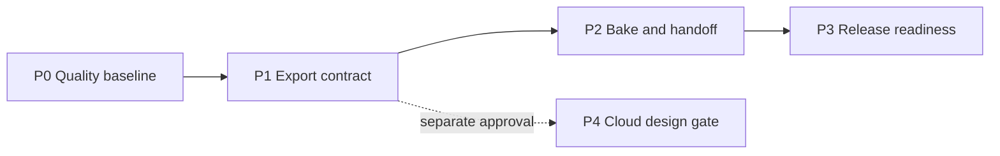

# Implementation Plan — G-AnnStudio G-Overlay Lab

| Field | Value |
| --- | --- |
| Generated by | RWANG implementation-plan |
| Source docs | [PRD-SDD v0.1](PRD-SDD-v0.1.md), [Architecture](ARCHITECTURE.md), [editor spec](g-overlay-lab-figma-editor-spec.md), [risk matrix](appendices/E-risk-matrix.md) |
| Preflight status | WARN — 0 critical, 2 warnings (content-taxonomy document control; cross-repository path-form ambiguity); see [report](.preflight-report.json) |
| Planning defaults | 2-week sprints, 25% risk buffer, medium granularity |
| Baseline | Local BannerProject editor and explicit 19-module layout sync exist. Sprint 3 adds deterministic BannerProject composition, Animated WebP handoff, timing preflight, and 22 focused tests. The cloud helper/projection and schema candidate are now implemented locally; hosted migration, UI conflict flow, and live cloud evidence remain open. |

### Sprint 1 execution status

Completed: Vitest runner pinned to a stable single-thread pool, six model/store tests, seven jsdom component tests (selection, grouping, visibility/lock, undo, marquee, inspector, preview), Node localStorage test shim, Vite build RCA, production build proof, and selective doc-code annotations. Sprint 1 is closed with 13 passing tests, type-check, and production-build evidence.

### Sprint 2 execution status

Partially completed: `BannerLayer.timing` is optional and the inspector exposes Start/End ms fields; `preflightBannerProject` is pure and returns validation issues without mutating the project. The cloud helper now brings the focused suite to 26 tests; the production build passes. This is not full release readiness: live bake/install, G-Maiden renderer smoke, hosted migration, cleanup retention, and signed-URL evidence remain open.

## 1. Scope summary

### Requirements and complexity

| ID | Scope | Points | Status |
| --- | --- | ---: | --- |
| FR-001 / GOE-001 | Local layer-project composition | 5 | Partially implemented |
| FR-002 / GOE-002 | Canvas and inspector parity | 5 | Partially implemented |
| FR-003 / GOE-004 | HUD event preview | 3 | Partially implemented |
| FR-004 / GOE-003 | Runtime-safe motion export | 13 | Partially implemented candidate |
| FR-005 | Explicit HUD-layout sync | 2 | Implemented |
| NFR-001..004 | Immutability, offline use, runtime compatibility, privacy | 10 | Cross-cutting |
| SDD-001..004 | Project separation, history, format boundary, local sync | 8 | Cross-cutting |

**Planned delivery total: 58 points.** The estimate includes the approved cloud contract and bounded implementation slice, but not production operations or public sharing.

### Out of scope

- Public sharing, collaboration, comments, marketplace, team ownership, account-security changes, cleanup-worker operation, and hosted production enablement.
- Any upload of GSI, CV, match, G-Log, account, or recovery data.
- Content-type taxonomy implementation (voice/sfx/banner project types) until its open owner questions are approved.
- A raw-video player inside the G-Maiden overlay.

## 2. Phasing strategy

| Phase | Sprint | Focus | Deliverable | Exit gate |
| --- | --- | --- | --- | --- |
| P0 | S1 | Quality baseline and local-editor proof | Testable local editor core | Focused tests and build RCA recorded |
| P1 | S2 | Motion export design and preflight | Candidate timing and read-only preflight contract | Encoded-byte measurement approved; failing-path tests retained |
| P2 | S3 | Bake and Ann Pack handoff | Runtime-safe exported banner | G-Maiden render smoke evidence |
| P3 | S4 | Hardening and release readiness | Release candidate evidence | All scoped tests/builds green |
| P4 | Gate | Private cloud C-3 design | Approved threat model/RLS contract | Approved 2026-08-14; implementation remains gated by migration evidence |
| P5 | S5 | Private project/asset sync | Owner-only Supabase tables, private bucket, manifest projection, revision conflict, and offline states | Local pgTAP/type/component tests; hosted deployment and cleanup evidence remain pending |

### Critical path

P0 → P1 → P2 → P3 is the release critical path. P4 is intentionally not a prerequisite for local G-Maiden authoring. P5 is an additive cloud track and must not become a dependency of local authoring or runtime handoff.

## 3. Sprint detail

### Sprint 1 — Local editor quality baseline

**Goal:** make the implemented composition surface reproducible and testable.

| Task | Req IDs | Points | Dependency |
| --- | --- | ---: | --- |
| Add the smallest frontend test runner and pure BannerProject tests | FR-001, NFR-001 | 5 | None |
| Component tests for selection, group visibility/lock, history, inspector, and marquee | FR-001, FR-002 | 5 | Test runner |
| Diagnose the Vite production-build timeout and record an RCA | NFR-002 | 3 | None |
| Add selective `@req` / `@spec` links to feature-boundary source files | SDD-001, SDD-002 | 3 | PRD-SDD |

**Total:** 16 points.  
**Definition of done:** Type-check, focused tests, and production build have evidence; no claim is based solely on manual canvas inspection.

### Sprint 2 — Motion export contract and preflight

**Goal:** define what can safely leave authoring as a G-Maiden banner.

| Task | Req IDs | Points | Dependency |
| --- | --- | ---: | --- |
| Measure and approve maximum duration, frame rate, dimensions, and encoded-byte output size | FR-004, NFR-003 | 3 | P0 build evidence; **open** |
| Define optional layer Start/End ms timing metadata and inspector fields | FR-004, SDD-003 | 5 | Implemented candidate; timeline/keyframes remain out of scope |
| Add pure export preflight for missing assets, unsupported layers, decode failure, duration, frame, and dimension budgets | FR-004, NFR-003 | 5 | Implemented candidate; encoded-byte rejection is gated on measurement |
| Add preflight error-path tests | FR-004 | 4 | Implemented; bake error-path tests remain dependent on bake wiring |

**Total:** 17 points.  
**Current evidence:** 26 focused tests and a production build pass; preflight and cloud projection do not mutate the last valid local project.
**Definition of done:** unsupported or over-budget exports fail without changing the last valid local project, after the encoded-byte budget is approved and measured on the target runtime.

### Sprint 3 — Bake and G-Maiden handoff

**Goal:** export a composed motion/static banner that G-Maiden can actually display.

| Task | Req IDs | Points | Dependency |
| --- | --- | ---: | --- |
| Connect visible composition and timing metadata to the existing Animated WebP bake path | FR-004, SDD-003 | 5 | S2 preflight |
| Install/export the generated asset through the existing Ann Pack boundary | FR-004 | 4 | Bake integration |
| Add G-Maiden renderer smoke proof for static and animated banners | FR-003, FR-004 | 4 | Install path |
| Verify that the existing layout-sync contract remains isolated | FR-005, SDD-004 | 2 | Handoff path |

**Total:** 15 points.  
**Definition of done:** a kill event uses the exported runtime-safe asset; no raw video or game data crosses the boundary.

### Sprint 4 — Release readiness

**Goal:** close local-authoring acceptance evidence without expanding into cloud work.

| Task | Req IDs | Points | Dependency |
| --- | --- | ---: | --- |
| Accessibility pass for icon controls, focus, keyboard inspector path, and reduced-motion preview | FR-002, NFR-002 | 4 | S1 tests |
| End-to-end authoring smoke: import, compose, preview, bake, export, install, event render | FR-001..004 | 4 | S3 |
| Resolve release-blocking preflight warnings or explicitly retain them as accepted debt | NFR-001..004 | 3 | S1-S3 |
| Update docs, graph, traceability, and release evidence | SDD-001..004 | 2 | All prior work |

**Total:** 13 points.  
**Definition of done:** all local-editor acceptance criteria have test/build/smoke evidence and remaining scope is explicitly deferred.

### Sprint 5 — Private project and asset sync (approved C-3/HIGH slice)

**Goal:** implement the approved owner-only cloud contract without changing the local-first or G-Maiden runtime boundaries.

| Task | Req IDs | Points | Dependency |
| --- | --- | ---: | --- |
| Add the G-Maiden `gstore` migration for `ann_projects`, `ann_project_assets`, and the private `ann-project-assets` bucket with explicit grants and RLS | GOE-005, NFR-004 | 5 | Approved threat model |
| Add recursive cloud-manifest validation and local-to-cloud projection (no paths, data URLs, GSI, CV, match, G-Log, or security data) | GOE-005, NFR-004 | 5 | Local BannerProject schema |
| Add revision compare-and-update, conflict states, signed-out/offline fail-closed behavior, and asset upload ordering | GOE-005 | 5 | Migration contract |
| Add pgTAP and frontend tests for anonymous/cross-account denial, forbidden JSON, path safety, conflict, and last-valid-local preservation | GOE-005, NFR-004 | 4 | Migration and client helpers |

**Total:** 19 points.
**Definition of done:** local tests and migration review prove the contract; the feature remains disabled until hosted migration, cleanup retention, signed-URL live smoke, and security-advisor evidence are recorded.

## 4. Team and milestones

### Suggested team

| Role | Allocation | Responsibility |
| --- | ---: | --- |
| Desktop engineer | 1.0 FTE | React, Tauri, bake/export, integration |
| QA / reviewer | 0.25 FTE | Test design, smoke evidence, release gate |
| Product/design owner | 0.25 FTE | Export budget, UX acceptance, cloud retention/quota and production gates |

This 1.5 FTE-equivalent team can target four sprints plus the required 25% buffer: approximately **10 calendar weeks**. A single engineer should treat this as 10–12 weeks.

| Milestone | Target | Gate |
| --- | --- | --- |
| M1 — Local editor evidence | End S1 | Tests and Vite build evidence exist |
| M2 — Export contract | End S2 | Measured limits and preflight are approved |
| M3 — G-Maiden banner handoff | End S3 | Static and animated renderer smoke passes |
| M4 — Local release candidate | End S4 + buffer | Acceptance, docs, and regression evidence complete |
| M5 — Cloud decision | Separate owner gate | Threat model and provider contract approved or deferred |

## 5. Risk register

| ID | Risk | Probability | Impact | Score | Mitigation |
| --- | --- | ---: | ---: | ---: | --- |
| R-001 | Vite build timeout masks a release regression | 3 | 4 | 12 | RCA in S1; require bounded build evidence |
| R-002 | Video export exceeds overlay budget | 3 | 5 | 15 | Measure limits before timeline/bake work |
| R-003 | Local storage quota loses a draft | 2 | 4 | 8 | Retain 3 MB limit; move to file-backed local storage only with tests |
| R-004 | Cloud sync leaks author or game data | 2 | 5 | 10 | Approved threat model, recursive DB/client manifest checks, dedicated tables/bucket, and cross-account tests; production remains gated |
| R-007 | Hosted cleanup/retention is missing after tombstone delete | 3 | 4 | 12 | Keep cloud control non-production until a separately audited service-role cleanup worker and retention interval are approved |
| R-005 | Interaction regressions are unobserved | 4 | 3 | 12 | Add focused unit/component tests in S1 |
| R-006 | Scope expands into content-type taxonomy | 3 | 3 | 9 | Keep taxonomy implementation out of this plan |

## 6. Deployment strategy

- **Local development:** Tauri/Vite desktop workflow with explicit G-Maiden availability checks.
- **Integration:** export/install smoke against a local G-Maiden instance.
- **Release:** use existing repository release rules; do not add feature flags or silent compatibility shims for this scope.
- **Cloud:** use the existing shared `gstore` Supabase project only through the approved `ann_` tables and private bucket. No hosted migration, client enablement, or service-role cleanup deployment is implied by this plan.

## 7. Requirement-to-sprint mapping

| Requirement | Sprint | Planned status |
| --- | --- | --- |
| FR-001 / GOE-001 | S1, S4 | Stabilize and validate |
| FR-002 / GOE-002 | S1, S4 | Stabilize and validate |
| FR-003 / GOE-004 | S3, S4 | Handoff smoke and acceptance |
| FR-004 / GOE-003 | S2, S3 | Implement |
| FR-005 | S3 | Regression boundary check |
| NFR-001 | S1, S4 | Test and release evidence |
| NFR-002 | S1, S4 | Build RCA and accessibility |
| NFR-003 | S2, S3 | Preflight and bake proof |
| NFR-004 | All sprints | Privacy boundary review |
| SDD-001..004 | S1-S4 | Traceability and architecture gates |
| GOE-005 | P4, S5 | Approved contract; S5 implementation and hosted evidence pending |

## CHANGELOG

| Version | Date | Status | Summary | Commit Hash | Agent |
| --- | --- | --- | --- | --- | --- |
| 0.1.0 | 2026-08-11 | beta | Generated a four-sprint local-authoring plan with a separately gated cloud decision. | pending | ATHER |
| 0.1.1 | 2026-08-11 | beta | Recorded Sprint 1 evidence: six tests, successful production build, and the Vite timeout RCA; component tests remain open. | pending | ATHER |
| 0.1.2 | 2026-08-11 | beta | Closed Sprint 1 with four jsdom BannerEditor component tests; 10 tests, type-check, and production build pass. | pending | ATHER |
| 0.1.3 | 2026-08-11 | beta | Stabilized Vitest on the local single-thread pool and completed the Sprint 1 component interaction coverage; 13 tests pass. | pending | ATHER |
| 0.1.4 | 2026-08-12 | beta | Recorded the implemented Sprint 2 candidate slice: optional layer timing, read-only preflight, 18 focused tests, and production-build evidence; encoded-byte measurement and runtime handoff remain open. | pending | ATHER |
| 0.1.5 | 2026-08-12 | beta | Corrected the preflight summary to the two recorded warnings and marked GOE-003 as a partially implemented candidate. | pending | ATHER |
| 0.2.0 | 2026-08-14 | candidate | Approved the C-3/HIGH threat model/RLS contract and added Sprint 5 for bounded owner-only cloud sync; hosted operations remain a release gate. | pending | ATHER |
